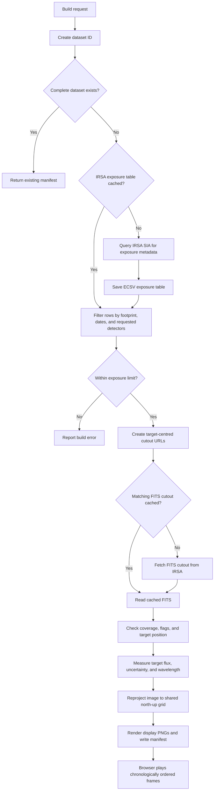
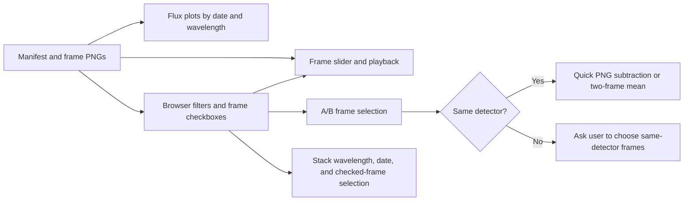
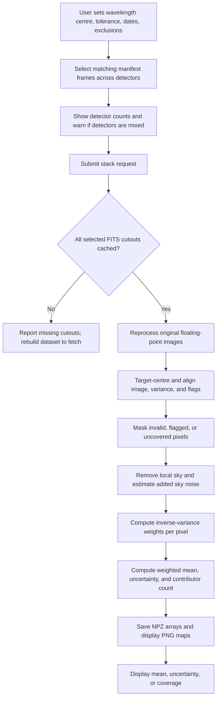

# How the SPHEREx data is processed

This guide follows the data from the moment someone presses **Show** to the
images and measurements shown in the browser. It is written for readers who
may not know astronomy or image processing. The app does not make a movie
directly from the archive search results: it checks and measures downloaded
images, aligns them, and then makes smaller display files.

## At a glance

```mermaid
flowchart LR
    INPUT[Target position<br/>and observation criteria] --> SEARCH[Find SPHEREx<br/>observations]
    SEARCH --> SELECT[Select exposures by<br/>coverage, date, detector]
    SELECT --> FITS[Retrieve calibrated<br/>FITS cutouts]
    FITS --> MEASURE[Check quality; measure<br/>brightness and wavelength]
    MEASURE --> ALIGN[Align images to a shared<br/>north-up grid]
    ALIGN --> FRAMES[Time-ordered images<br/>and measurements]
    FRAMES --> OUTPUT[Time-series data<br/>for viewing and analysis]
    FRAMES --> STACKSEL{Make a<br/>multi-frame stack?}
    STACKSEL -- No --> OUTPUT
    STACKSEL -- Yes --> WAVELENGTH[Select by wavelength,<br/>dates, and exclusions]
    WAVELENGTH --> REPROCESS[Reprocess FITS and<br/>align on the target]
    REPROCESS --> COMBINE[Mask invalid pixels;<br/>combine by inverse variance]
    COMBINE --> STACKOUT[Stacked image,<br/>uncertainty, coverage]

    classDef input fill:#dbeafe,stroke:#2563eb,color:#172554,stroke-width:2px
    classDef archive fill:#ffedd5,stroke:#ea580c,color:#431407,stroke-width:2px
    classDef processing fill:#ede9fe,stroke:#7c3aed,color:#2e1065,stroke-width:2px
    classDef product fill:#dcfce7,stroke:#16a34a,color:#052e16,stroke-width:2px
    classDef optional fill:#fef3c7,stroke:#d97706,color:#451a03,stroke-width:2px
    class INPUT input
    class SEARCH,SELECT,FITS archive
    class MEASURE,ALIGN processing
    class FRAMES,OUTPUT product
    class STACKSEL,WAVELENGTH,REPROCESS,COMBINE,STACKOUT optional
```

### Observation search and movie build

### What the browser does with a completed dataset

### On-demand multi-frame stack

An **exposure row** is one detector image listed by the archive. One
observation can have rows from several detectors. A **frame** is one usable
detector image after it has been downloaded, checked, measured, and aligned.
Some rows are skipped, so the final frame count can be lower than the archive
result count.

## 1. The page sends a request

The browser sends target coordinates, field of view (FOV), date limits,
selected detectors, and the tracking choice to the Flask app. The target may
come from the curated list, a name resolved by the server, or explicit right
ascension (RA) and declination (Dec). Curated targets can have known proper
motion values. Other targets are treated as fixed unless proper motion is
provided in the app's target data.

The server checks the coordinates, FOV, dates, and detector names. It creates
a dataset ID using the request and the pipeline version. If a complete dataset
with that ID already exists, it can be returned without rebuilding it. The ID
changes when the target, FOV, dates, detector list, tracking choice, or
pipeline version changes.

FOV sets the size of each final image. It does not request more observations
from the archive or create more frames.

## 2. Search the archive

The pipeline queries IRSA, NASA/IPAC's Infrared Science Archive, through its
Simple Image Access (SIA) service. It currently searches the `spherex_dr1` and
`spherex_qr3` collections. The query uses a small 0.02-degree circle around
the target's current or predicted position. IRSA returns a table of image
metadata, including detector, observation time, image footprint, and a URL for
retrieving a cutout.

The search circle is used to find archive images whose footprints might cover
the target; it is separate from the requested FOV. The returned table is
cached in `cutout_cache/` as an ECSV file. ECSV is a text table format that
preserves the column names and data types. If the cache exists, the app can
reuse it instead of repeating the archive search.

Before applying the selected date range, the app finds the median observation
time across the archive rows. It calculates the target's position at that
time, which becomes the shared centre for downloaded cutouts. Then it applies
the chosen date limits. The end date includes the whole selected day.

## 3. Check that the target is on each detector

SIA can return an image that only clips the edge of its search circle. The
pipeline compares the archive's detector-footprint polygon with the target's
position at each exposure date. It uses a gnomonic sky projection for this
comparison. That projection handles RA wrap and works near the celestial
poles, where a flat RA/Dec approximation can distort footprints.

Rows whose footprints do not contain the target are removed. The selected
detectors are applied after this check. The manifest records both the
requested detector list and the detector bands that had candidate exposures.
Selecting all six detectors does not guarantee that every detector has an
exposure for every target.

To limit download and disk use, the app refuses a request with more than 500
candidate exposures. This is checked before downloading.

## 4. Download FITS cutouts

For each remaining row, the pipeline asks IRSA for a square cutout centred on
the target's position at the median archive time. The cutout is larger than
the final image so there is room to rotate and resample it. The app selects a
fixed size tier large enough for about 1.5 times the requested FOV. For
example, a 0.3-degree final field uses a 0.5-degree cutout.

The response is a FITS file. FITS is an astronomy format that stores several
related image layers together. The pipeline uses:

- `IMAGE`: calibrated sky brightness in megajanskys per steradian (MJy/sr).
- `VARIANCE`: estimated noise variance for each image pixel.
- `FLAGS`: bit fields that mark pixels with known issues.
- `ZODI`, when present: a model of the zodiacal-light foreground.
- WCS metadata: the mapping between pixels and sky coordinates, including
  the wavelength calibration.

Other extensions, such as the PSF model (`EPSF`), are not used. Cutouts are
downloaded in parallel (eight workers by default), retried for some temporary
server errors, and cached in `cutout_cache/`. The cache key is the cutout URL,
so a later request can reuse the same file. A larger cached cutout can also
satisfy a smaller request. If IRSA reports that the position is not covered,
or a cutout cannot be read, the row is skipped.

## 5. Locate the target and measure brightness

Every FITS image has its own WCS. The pipeline uses it to turn the target's
sky position at the exposure date into an image pixel. This date-specific
position accounts for proper motion where known. If the target falls outside
the returned cutout, that row is skipped.

When the `ZODI` layer exists, it is subtracted from `IMAGE` before measurement.
This removes an estimated glow from dust in the Solar System. The pipeline
then measures a small circular aperture around the target:

1. Pixels with non-finite image or variance values, non-positive variance, or
   a bad quality flag are ignored. `SOURCE` and `FULLSAMPLE` are treated as
   benign flags; other flag bits are considered bad for the measurement.
2. The target aperture has a radius of 2 image pixels. A surrounding ring,
   normally 6 to 12 pixels from the centre, estimates the local sky level. If
   that ring has too few good pixels, a wider fallback ring is tried.
3. The median value in the ring is subtracted from each usable aperture pixel.
   This estimates the target's brightness above the local background.
4. The uncertainty combines the FITS variance with the scatter in the sky
   ring. The scatter uses the median absolute deviation, which is less
   sensitive to a few unusually bright pixels than a standard deviation.
5. The pixel sum is converted from MJy/sr to microjanskys (uJy) using the
   pixel's sky area from the FITS header. A fixed 1.25 aperture correction
   estimates light outside the small aperture.

The app also records wavelength and bandwidth at the target's actual pixel.
Wavelength varies across a detector, so these values are read from the FITS
wavelength WCS at that location. Peak-pixel signal-to-noise and the offset of
nearby light from the expected target position are recorded as context and
quality indicators. If there are too few good pixels for photometry, the
image may still be shown, but its flux measurements are empty.

These are aperture measurements from calibrated cutouts. The app does not
perform PSF fitting or calculate a spectrum for every image pixel.

## 6. Align images on a shared grid

Images from different exposures can have different rotations and pixel
locations. The pipeline reprojects each image onto one square, north-up grid
centred on the reference position. It uses a tangent-plane sky projection and
a fixed scale of 6.1577 arcseconds per pixel. FOV changes the number of
output pixels, not their scale or detail.

With tracking off, the grid stays fixed on the sky, so a moving target may
shift between frames. With tracking on, the grid is shifted for each date so
the target stays at the centre. Reprojection interpolates image values onto
the shared grid. Locations outside the original cutout become no-data pixels.
The web build reprojects only the image plane because measurements have
already been made on the original calibrated cutout.

Large FITS arrays are released after each image is aligned to keep memory use
manageable.

## 7. Create frames and the manifest

The app saves one PNG per final frame in `data/<dataset-id>/frames/`, along
with a `manifest.json`. The manifest records the request, output grid,
summary, and per-frame date, detector, wavelength, measurements, flags, and
image filename. The browser uses it to connect each displayed image to its
metadata.

For display, each aligned frame has its median level removed. The app then
chooses a shared brightness stretch for all frames from each detector, using
the 1st and 99.5th percentiles. One stretch per detector helps real brightness
changes remain visible between visits. The resulting PNGs are 8-bit display
images: zero means no coverage, and valid pixels use values 1 through 255.
This compact representation is for viewing, not precision measurement.

For a new request, the app first makes a quick preview from up to 12 evenly
spaced exposures in the detector with the most candidate rows. It then
downloads and processes the full selected set. When the full build completes,
its manifest replaces the preview manifest.

## 8. Display, filters, plots, and comparisons

The browser loads the manifest and PNGs, then draws the selected frame on a
canvas. Its interpolation choice (nearest, bilinear, bicubic, Lanczos, or
Gaussian) affects only how pixels look when enlarged. The grayscale/colour
palette and black/white display levels also do not change the FITS data or
measurements.

The Frames panel's wavelength window and per-frame checkboxes hide frames in
the browser. They do not delete frames from the manifest or rebuild the
dataset. The plots use the measured per-frame flux against date or wavelength;
they are not per-pixel spectra.

The A-B and average comparison images are generated from the displayed 8-bit
PNGs and cached in the dataset directory. They are quick visual comparisons,
not scientific flux subtraction. Comparisons are restricted to one detector
because different detectors observe different wavelengths.

The separate Stack panel reprocesses selected cached FITS cutouts to recover
the floating-point images and variance maps. It selects frames by an
effective-wavelength window at the target, optional dates, and the ticked frame
rows. The centre can be entered exactly or moved with a slider spanning the
minimum to maximum wavelength available in the dataset. All detectors are
eligible, so a sufficiently wide window can include multiple detectors. The
UI lists their contributor counts and warns about cross-detector stacks because
their spectral responses and point-spread functions differ. Each image is
target-centred even if the movie is
sky-locked. A local residual sky level is removed from each image; bad-flagged
or uncovered pixels do not contribute. The weighted mean is
`sum(image / variance) / sum(1 / variance)` at each pixel, and its estimated
uncertainty is `sqrt(1 / sum(1 / variance))`. The coverage map counts valid
contributions. The mean, uncertainty, total weight, and coverage arrays are
saved as floating-point/integer data in a compressed NPZ; the PNG views are
stretched for display. The wavelength stored in the manifest is the effective
wavelength at the target pixel, retained to six decimal places for selection.
If any selected FITS cutout is missing from cache, the stack stops with an
error; rebuilding the dataset fetches required cutouts again. The first stack
selection is computed once and cached at
`data/<dataset-id>/stacks/<stack-id>/`.

The uncertainty is an estimate rather than a full covariance calculation:
the pipeline resamples each variance image onto the common grid with the same
interpolation routine used for the image. This does not account for
correlations between neighbouring output pixels introduced by resampling.

## What is cached

| Location | Contents | Reused for |
| --- | --- | --- |
| `cutout_cache/exposures_*.ecsv` | IRSA exposure metadata table | Repeating an archive search for the same target coordinates |
| `cutout_cache/*.fits` | Downloaded calibrated cutouts | Rebuilding dates, FOV, or detector selections that need the same cutouts |
| `data/<dataset-id>/` | Manifest, rendered PNG frames, comparison PNGs, and cached stack outputs under `stacks/` | Returning the same completed request or identical stack without recomputing |

The cutout cache can become large. Removing it makes future requests download
the FITS files again. Removing a dataset directory makes the app render that
request again, but it can reuse the FITS cutouts.

## Important interpretation notes

- Archive rows, usable frames, and visible frames are different counts.
  Archive rows may be rejected for footprint, download, or cutout reasons.
  Browser filters can then hide valid frames.
- A frame is one detector image, not necessarily one unique observation
  time. Several detector frames may share an observation ID and date.
- Colour in the browser is a false-colour brightness palette; the detector
  did not capture visible colour.
- Use the manifest's `flux_ujy` and `err_ujy` for the pipeline's numerical
  measurements. PNG pixels are reduced to 8-bit values for display.
- Proper motion is applied only when the app has proper-motion values for the
  target. Unknown targets are treated as fixed positions.
- The final count can be lower than the number of candidate rows because
  cutouts can fail, omit the target, or produce no usable aligned image.

## Where this happens in the code

- `app.py` validates requests, queues builds, and serves manifests, frames,
  and comparison images.
- `test.py` contains the archive query, footprint check, FITS download/cache,
  target location, photometry, and alignment logic.
- `dataset.py` coordinates preview and full builds, renders PNGs, and writes
  the manifest.
- `static/app.js`, `static/viewer.js`, and `static/plots.js` implement browser
  playback, display controls, filters, comparisons, and measurement plots.
